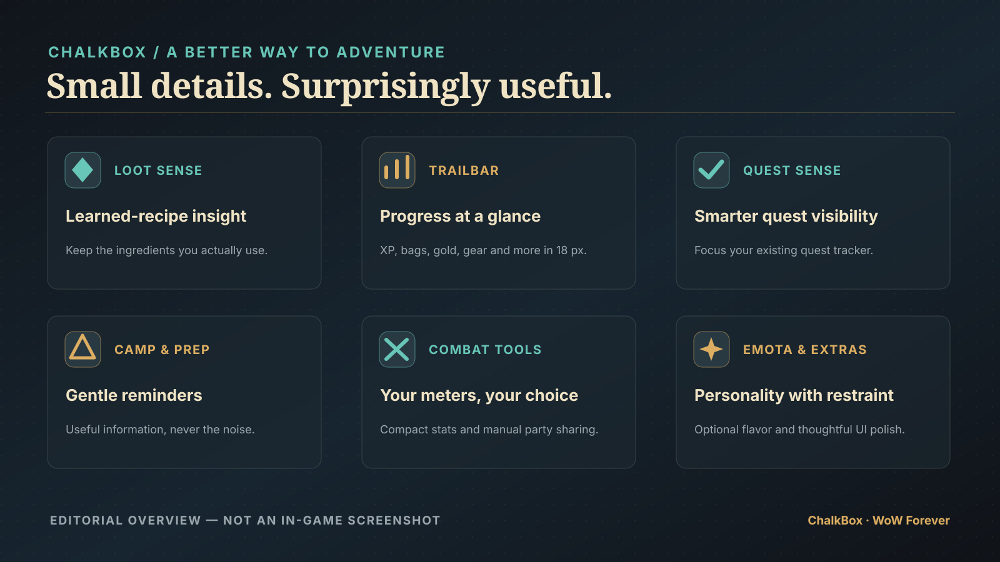

<div align="center">


# ✦ ChalkBox

### A quieter, smarter way to adventure in **World of Warcraft: Forever**

**Keep what matters. See what helps. Play without the clutter.**

[](https://github.com/detok/ChalkBox/releases)
[](https://github.com/detok/ChalkBox/actions/workflows/release.yml)
[](LICENSE)
[](https://github.com/detok/ChalkBox)

### [⬇ Download ChalkBox 1.9.3](https://github.com/detok/ChalkBox/releases/download/v1.9.3/ChalkBox-1.9.3.zip)

[**All GitHub Releases**](https://github.com/detok/ChalkBox/releases) · [**Install Guide**](#-install-in-one-minute) · [**Features**](#-what-chalkbox-does) · [**Help & Bugs**](https://github.com/detok/ChalkBox/issues)

</div>

> [!IMPORTANT]
> **GitHub is ChalkBox's primary download home.** You can install it directly from GitHub Releases, without a CurseForge account or application. A CurseForge listing is being prepared as an **additional** distribution option, not a replacement for GitHub.

---

## 🧭 What is ChalkBox?

ChalkBox is a **single, self-contained WoW Forever utility addon** for the moments between the big fights: recognizing items worth checking before you sell, keeping quests visible, tracking progress, remembering camp benefits and sharing combat results with your party.

It adds **small, genuinely useful information** while keeping Blizzard's familiar UI wherever possible. No second recipe addon, no online service, no random windows for every task.

<div align="center">

**ONE ADDON** · **ONE ZIP** · **ONE SETTINGS MENU**

</div>

## ✨ What ChalkBox does

| Module | What you get | Why it matters |
| :--- | :--- | :--- |
| **📦 LootSense** | Native-styled item insights, verified **learned-recipe bag highlights**, and quest/crafting/camp hints | Know *why* loot matters and spot the reagents you actually use |
| **🧪 ProfessionSense** | Learned-recipe reagent scans, quantities where the client allows, 2,511 bundled Forever recipes | No separate crafting database download |
| **📈 The Bar** | Adaptive **18px** XP/bag/gear/rested/pet dashboard with **right-click controls**, repair quotes/estimates, optional Junk/Total bag resale and drag-to-reorder layouts | Arrange every stat where you want it without an extra window |
| **⚔️ Combat Meter** | Compact DPS/DMG/HPS/HEAL/TAKEN/INT, class icons, draggable window, PRINT/RESET | A readable optional meter using Blizzard's own data |
| **💬 Blizzard meter PRINT** | A new **PRINT top 3 to PARTY** entry in Blizzard's existing damage-meter gear menu | Keep the **native** meter and still share a concise fight report |
| **📜 QuestSense** | Smart / Nearby / All accepted-quest watch modes in the native tracker | Stay focused without inventing map pins or quest arrows |
| **⛺ Adventure Prep** | Camping aura/tent awareness, optional movable top-screen toast, class/pet reminders | Useful reminders with less nagging |
| **🛡️ QuietGuard** | Guild/duel invite protection; other restrictions optional | Less invite spam while keeping ordinary party play available |
| **🎭 Emota** | Opt-in contextual emotes, **race behavior selector**, adjustable racial flavor and emote catalog | A little personality, now configurable by race |
| **🎒 Bag position helper** | Vertical **−120 to +120** offset, with Blizzard's original position at the midpoint | Move individual bag windows up or down intuitively |

Every module has native in-game options. **No automated item selling, no fabricated quest locations, no automatic PARTY combat spam.**

---

## 🖥️ See it in action

**The original ChalkBox artwork is ready.** The image below is an **editorial feature illustration, not an in-game screenshot**. Authentic Forever screenshots of current addon features are still pending. No fictional gameplay UI is used.



[Full-size hero illustration](curseforge/artwork/chalkbox-hero-1600x900.svg) · [Brand identity guide](docs/BRANDING.md) · [Artwork sources](curseforge/artwork/ARTWORK_FOLDER.md)

Artwork specification and game-capture shot list: [CurseForge / GitHub media plan](curseforge/ARTWORK_TO_CREATE.md) · [Screenshot checklist](curseforge/artwork/SCREENSHOT_PLAN.md).

These screenshots will be added when we have verified captures of LootSense, TrailBar, Blizzard's meter gear-menu PRINT, QuestSense and the settings pages.

## ✨ New in 1.9: real in-game polish

**ChalkBox now feels more like part of WoW's interface.** TrailBar modules can be dragged between left, center and right with saved personal ordering; the bar's background fades independently of its text; LootSense now uses a restrained **Item Insight** tooltip instead of a technical prefix; real learned-recipe ingredients receive subtle green inventory insets; Emota offers configurable racial flavor; and Blizzard's separate-bag adjustment finally has a vertical, centered control.

Everything is optional or reversible. Existing modules, presets, screen-space reservation and combat safeguards stay intact.

## 📦 LootSense: a reason to keep it

Some items belong to a quest. Some are ingredients in **recipes your character knows**. Some have real camp utility. And some have only a **potential recipe use** according to the bundled Forever catalog.

ChalkBox now explains that difference through a subtle **CHALKBOX | ITEM INSIGHT** section using native tooltip text instead of `LootSense: ...`:

- **Keep this item** — a personal protected item or verified quest relevance
- **Used in a learned recipe** — an observed learned recipe uses this reagent
- **Possible crafting use** — the bundled catalog found a recipe, but it's **not verified as learned**
- **Possible profession material** — a cautious craft-family match, not a promise
- **No extra section** — no strong evidence; **that does not mean safe to sell**

**New in v1.9:** a restrained green inset highlights eligible ingredients right in Blizzard's bag icons **only** when the character's actual learned-recipe scan proves a use. Unlearned/offline-catalog possibilities never glow. Turn this on/off or adjust the marker strength in **ChalkBox → LootSense Appearance**. It never replaces a bag slot or item rarity border.

**There are 2,511 Forever recipes included in the ZIP.** The optional hints and character-specific learned-recipe scanner are deliberately distinguished. Open your crafting profession window once and use `/chalk loot scan` if you want to refresh its knowledge.

ChalkBox **never** sells, buys, deletes, trades or uses items for you.

## 📈 TrailBar: more information, same 18 pixels

**Expanded in v1.8.6 and customizable in v1.9.0.** TrailBar shows far more than XP and gold, yet stays the **same 18 pixels tall**. It's a customizable status dashboard—not a big floating window.

| Module | What you see | Mouseover detail | Default |
| --- | --- | --- | --- |
| **Level** | Level + XP % | Exact XP amounts | Always |
| **XP rate** | XP/hour | Session earnings | On |
| **To level** | ETA | Estimate methodology | On |
| **Bags** | **12 free** (example) | Total bag slots, general vs. profession-only free slots | **On** |
| **Gear** | **87%** (example) | Weighted equipped durability and lowest-condition item | **On** |
| **Rested** | **42%** (example) | Bonus XP and percent of one level; separate from camp buffs | **On** |
| **Pet** | **95%** or **Pet none** (Hunters) | Pet health when the client permits it; protected values show unavailable | On for Hunters |
| **Latency** | World ping in ms | Home and world latency separately | Off |
| **Session** | Time online | Session duration | On |
| **Gold** | Current gold + net change | Net gold per hour | On |

### Layouts that fit

In **Esc → Options → AddOns → ChalkBox → The Bar Stats**, turn each module on or off. Or choose **Balanced** (recommended), **Minimal** (level, bag space, gold), or **All**. The bar automatically hides low-priority numbers when the screen is too narrow to fit them—**no overlapping labels** or overflowing off-screen. Widening your UI makes those enabled fields appear again. Hover items for useful detail.

Try `/chalk bar stats` to inspect enabled vs. currently visible modules. `/chalk bar stats all` turns everything on; `/chalk bar stat latency on` enables the world ping field. A metric whose Forever API is unavailable stays hidden rather than making up a number.

### Drag-and-drop edit mode (v1.9)

Open **ChalkBox → The Bar Appearance → Edit Bar**. The modules gain small edit highlights. Drag any stat to another position inside the **Left / Center / Right** third of the strip; dropping over an existing module reorders the current section. **Right-click while editing** to cycle the module's own left/center/right text alignment. Click **Done Editing** to relock; **Reset Layout** restores the stock order. Each character saves its own layout.

The bar background is now **Blizzard-inspired neutral charcoal**, with a live **0–100% opacity slider** on the same page. At **0%**, only your information and XP underline remain visible. This slider does **not** fade text.

Advanced commands: `/chalk bar edit on`, `/chalk bar edit off`, `/chalk bar move bags right 1`, `/chalk bar align gold center`, `/chalk bar layout reset`, `/chalk bar opacity 0`.

The strip still supports **top / bottom / hidden**, 18px **Reserve screen space** (default), and a tiny XP progress line. Use `/chalk bar status` for layout diagnostics.

If separate bags stack too high, **ChalkBox → The Bar** now has a proper **vertical position slider**: **Blizzard's original anchor is at the midpoint (0)**. Drag the thumb **down** to lower bags (+120 maximum), or **up** to lift bags (−120 minimum). **Reset Bags** returns to Blizzard's default instantly. Combined bags, slots and sorting remain untouched. Slash alternatives: `/chalk bags offset 40` (down), `/chalk bags offset -35` (up), `/chalk bags reset`.

### New in 1.9.3 — Repair Learning: a self-calibrating estimate

The Bar now **learns from real merchant repair quotes** rather than replacing one rate with another. Each character retains up to **32 unique repair observations** and uses a robust average of relevant price-per-durability samples to make a better approximate prediction away from merchants. Exact gear matches are preferred; very different gear sets require another sample. Identical merchant quotes aren't repeatedly counted by the five-second update timer.

- At a repair merchant: exact `Repair 2g` quote (when available), with an automatic nonduplicated training example.
- On the road: **`Repair ~2g`**, marked approximate. Hover to see how many unique observations were saved, whether this gear matches learned samples, confidence stage, and how far off the last estimate was at a subsequent vendor visit.
- Before any usable sample: `Repair --`. A 1.9.2 saved calibration remains usable as an initial fallback until the new history collects examples.
- `/chalk bar repair status` shows learned quote count and most recent prediction error; `/chalk bar repair reset` clears this character's training history, including the legacy calibration.
- No online account, external dataset, transaction, automatic repair or invented exact price. Merchant discounts, damaged items in bags and different gear still affect real costs.

### New in 1.9.2 — The Bar: repair estimates and right-click controls

**TrailBar is now called The Bar** in menus and documentation. All your existing `/chalk bar` commands and saved per-character placements still work. The Bar gets a new **Repair** module (enabled by default):

- **At a repair merchant:** see the **exact repair-all quote** from the client.
- **Away from a merchant:** see **`Repair ~2g`**, explicitly a wear-based approximation scaled from an earlier vendor quote. Before the first usable quote, see **`Repair --`**, never an invented gold amount.
- **Hover:** see the quote/estimate source, equipped durability lost, and the warning that repairs of gear in bags and discounts may change the final bill. No automatic repairs or payments.
- **Right-click any visible stat:** show/hide the module, move it between the Bar's left/center/right thirds, adjust its text alignment, change The Bar position, open native settings, or enter Edit Mode. The blank bar background opens the general controls; you can restore a hidden module there.
- **Bag resale still switches Junk / Total on left-click.** In Edit Mode, the established right-click alignment shortcut remains. Menus use Blizzard's own menu API with a legacy dropdown fallback when necessary.

Enable/disable with `/chalk bar stat repair on|off` or **Esc → Options → AddOns → ChalkBox → The Bar Stats**.

### New in 1.9.1 — Bag resale value: Junk / Total

Enable **Bag vendor value** in **ChalkBox → The Bar Stats**, or use `/chalk bar stat bagvalue on`. The compact bar now shows **Value 18g** for the known resale total of all equipped bag items. **Left-click the number** (outside Edit Mode) to switch it to **Junk 1g** — only grey/poor-quality items. Left-click again to return to total. There is also a **Value: Total / Value: Junk** toggle right in TrailBar Stats; the selected view persists across logins.

Hover either mode for exact gold/silver/copper values for **both** totals, stack-aware calculations and explanations of any uncached item data. An incomplete total is marked `>=`: that means **at least** this much, not a guaranteed exact figure. This is vendor resale money, **not auction-house value**, and does not include bank items, equipment you are wearing or gold you already carry. ChalkBox never sells anything.

`/chalk bar bagvalue junk`, `/chalk bar bagvalue total`, or `/chalk bar bagvalue toggle` also switch the selected display.

## ⚔️ Combat: your choice of meter

### Prefer Blizzard's built-in damage meter?

Keep it. ChalkBox **v1.8.5** extends the native Forever damage meter's existing **gear menu** with **ChalkBox: PRINT top 3 to PARTY**. It follows the selected **native** meter statistic and fight (including saved sessions when available).

It sends **one manual, after-combat PARTY message**, only when you are actually in a normal party and Forever exposes non-secret numbers. No automatic reporting, no raid or public-chat fallback. Combat-protected values are never formatted or leaked.

Use `/chalk meter hide` to hide the *extra* ChalkBox window while leaving the Blizzard integration enabled. Use `/chalk meter native status` to check the integration.

### Prefer ChalkBox's compact window?

That's included too:

- Modes: **DPS / Damage / HPS / Healing / Damage Taken / Interrupts**
- Scope: **Fight / Last / Overall**
- Class-colored rows with genuine WoW class badges; optional spec art where available
- Drag, resize, **LOCK**, opacity **35–100%**, 5/8/12 row layouts
- **PRINT** to PARTY after combat
- **RESET** with confirmation; it clears *shared Blizzard session data*, not just ChalkBox

**Client note:** the built-in gear-menu addition, separate-bag offset and newest TrailBar native-data widgets have Lua tests, but still need real-world Forever-client confirmation. If your client blocks an action or secret value, ChalkBox reports that rather than guessing.

## 📜 Quests, camping and a little personality

**QuestSense** reads your real accepted quests and updates Blizzard's native tracker. Its **Smart** mode prioritizes current-zone and recently accepted quests then fills available watch slots. **Nearby only** and **All accepted** are also available. Manually watched quests are respected, and changes wait when the game is in a restricted state. This is **watch management**, not a Questie replacement or a route finder.

**Adventure Prep** checks supported **Camp Benefits**, **Welcoming Campfire**, Camp Tent/rested-XP indicators and relevant supplies. Optional top-screen notifications fade automatically. You can move the toast, set its opacity and lock it to avoid stealing game clicks. Test it with `/chalk prep test`.

**QuietGuard** helps against unwanted guild invitations and duels, with party/trade/channel filtering **off by default**. **Emota** offers optional randomized character emotes and an emote catalog; automatic idle behavior starts **disabled**. The new **Emota Race Behavior** page lets you inspect existing racial presets and choose **Off / Subtle / Default / Expressive** flavor intensity. Races without their own weighted profiles are visibly marked **planned**, never advertised as working.

---

## 🚀 Install in one minute

**Direct download:** [**ChalkBox 1.9.3 ZIP**](https://github.com/detok/ChalkBox/releases/download/v1.9.3/ChalkBox-1.9.3.zip)  
**Newer versions:** [**GitHub Releases**](https://github.com/detok/ChalkBox/releases)

1. Download **`ChalkBox-<version>.zip`** from GitHub Releases — *not* the GitHub “Source code” archives.
2. In Battle.net, select **WoW Forever → Show in Explorer/Finder**. Open that installation's `Interface/AddOns` folder.
3. Extract the included **ChalkBox** folder directly into **AddOns**. It should look like:

   ```text
   World of Warcraft/
     _forever_/
       Interface/
         AddOns/
           ChalkBox/
             ChalkBox.toc
             ChalkBox_Camelot.toc
             Core.lua
             ...other included addon files
   ```

4. Enable **ChalkBox** from the character-select AddOns screen, then log in. Type **`/chalk`** or **`/cb`**.

> [!TIP]
> If the addon doesn't appear, check for the common **double-folder** mistake: `AddOns/ChalkBox/ChalkBox/ChalkBox.toc`. The `.toc` must sit directly under `AddOns/ChalkBox/`.

Your settings live in WoW SavedVariables; you don't need to delete `WTF` when updating.

### First five minutes

1. **`/chalk`** → explore the native addon settings.
2. Open your crafting profession window, wait for the list, then **`/chalk loot scan`**; hover a useful reagent.
3. **`/chalk prep test`** → preview the Adventure Prep toast.
4. **`/chalk quests status`** → check accepted quests and watch state.
5. Use Blizzard's damage meter or the optional ChalkBox one. Hide the latter with **`/chalk meter hide`**.

[Full user guide](docs/USER_GUIDE.md) · [Troubleshooting](docs/TROUBLESHOOTING.md) · [Release notes](docs/RELEASE_NOTES.md)

## ⌨️ Commands

| Command | What it does |
| --- | --- |
| `/chalk` / `/cb` | Open all native settings |
| `/chalk keep [item]` / `forget [item]` | Protect or unprotect a specific item |
| `/chalk loot scan` / `status` | Refresh or diagnose profession/recipe data |
| `/chalk quests status` / `smart` | Inspect or change quest tracking |
| `/chalk bar top` / `bottom` / `off` | Place or hide the status strip |
| `/chalk bar stats all` / `balanced` / `minimal` | Set TrailBar information density |
| `/chalk bar stat gear off` / `latency on` | Control individual widgets |
| `/chalk bar edit on` / `off` | Drag/reorder bar modules, then lock the layout |
| `/chalk bar opacity 0` / `100` | Adjust only the neutral charcoal background |
| `/chalk bar layout reset` | Restore the current character's default stat positions |
| `/chalk bags offset -35` | Move separate bags upward relative to Blizzard's anchor |
| `/chalk bags offset 30` / `reset` | Reposition individual bag windows or restore default |
| `/chalk meter hide` / `show` | Toggle the extra ChalkBox combat meter |
| `/chalk meter print` | Manually report top-three compact-meter results to PARTY after combat |
| `/chalk meter native on` / `off` / `status` | Configure Blizzard's gear-menu PRINT feature |
| `/chalk meter reset` | Confirm before resetting all shared damage-meter sessions |
| `/chalk prep test` | Preview the reminder toast |
| `/chalk emota idle preview` | Preview a random Emota reaction |
| `/chalk help` | Command overview |

**More:** [Full command reference](curseforge/copy/COMMANDS.md).

<details>
<summary><strong>❓ FAQ and common questions</strong></summary>

**Do I need CurseForge?** No. GitHub Releases is a complete direct-download option, with the same installable addon.

**Does ChalkBox automatically sell things?** No. Item advice is deliberately advisory.

**Is it for WoW Classic or Retail?** The project is focused on **WoW Forever / Camelot**. Do not assume other WoW flavors are fully supported.

**Does the native DPS print always work?** It can refuse reports while fighting, in raids/solo, or when data remains protected. That is by design.

**Does it replace bags?** No. The separate-bag offset only changes a native layout anchor.

**Can empty Action Bar 2 buttons disappear?** Yes via **Blizzard Edit Mode → Action Bar 2 → Always Show Buttons: off**. This is a **game feature**, not part of ChalkBox.

**More questions:** [Complete FAQ](curseforge/copy/FAQ.md).

</details>

## 🛠️ Help, bugs and feedback

ChalkBox is a **public prerelease**. Its Lua 5.1 tests and installable ZIP are validated automatically, but real Forever-client integrations can vary by build and client restrictions.

If you find a bug, [**open a GitHub issue**](https://github.com/detok/ChalkBox/issues) with:

- ChalkBox version and Forever build
- Exact steps to reproduce
- Expected versus actual behavior
- Relevant Lua errors, tooltip/chat text or a screenshot with private details removed

Issues: https://github.com/detok/ChalkBox/issues

## 🔧 Developers and contributors

This repository contains the **installable `ChalkBox/` addon**, Lua tests, a reproducible Python ZIP packager and an optional **`curseforge/` publishing kit**. The latter is **documentation and marketing only**; it is not distributed inside the game addon.

```bash
# Verify Lua 5.1 syntax and run all module tests
find ChalkBox tests -name '*.lua' -print0 | xargs -0 luac5.1 -p
for test in tests/test_*.lua; do (cd ChalkBox && lua5.1 "../$test"); done

# Build/test the one installable ZIP
python3 scripts/test_packages.py
```

GitHub Actions runs checks on pull requests and main, publishing `ChalkBox-<version>.zip` when a new version first reaches `main`. Subsequent documentation-only commits **preserve** the existing release rather than rewriting its tag.

[Contributing](CONTRIBUTING.md) · [Development notes](docs/DEVELOPMENT.md) · [Recipe data provenance](docs/RECIPE_DATA.md) · [CurseForge publishing kit](curseforge/README.md) · [Changelog](CHANGELOG.md)

## ⚖️ Credits and license

**ChalkBox by Detok** · [MIT licensed](LICENSE).

Includes separately MIT-licensed **LibProfessionDB 1.9.1 by Pimptasty** (2,511 Forever recipes) and the public-domain **LibStub** loader, with original copyright/licenses preserved in the installable ZIP.

Full credits: [NOTICE.md](NOTICE.md).

**Privacy:** ChalkBox stores options and profession observations locally using WoW SavedVariables. It does not require a separate account or external service.

**Independent community addon. Not affiliated with Blizzard Entertainment or CurseForge.**

<div align="center">

---

**ChalkBox** · *A quieter, smarter way to adventure.*

[**⬇ Download**](https://github.com/detok/ChalkBox/releases) · [**💬 Report a bug**](https://github.com/detok/ChalkBox/issues) · [**📖 User guide**](docs/USER_GUIDE.md)

</div>
