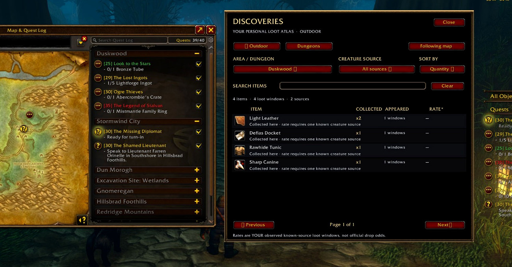

# ChalkBox

**One addon. Better information. Less UI clutter.**

Quality-of-life tools for **World of Warcraft: Forever** — loot discoveries, quests, professions, auction prices, macros, a compact HUD, combat information and a little personality.

[**Releases (including prereleases)**](https://github.com/detok/ChalkBox/releases) · [**Install & first run**](docs/GETTING_STARTED.md) · [**Player handbook**](docs/USER_GUIDE.md) · [**Documentation home**](docs/README.md) · [**Report a problem**](https://github.com/detok/ChalkBox/issues/new/choose)

ChalkBox installs as **one `ChalkBox` folder**. Its bundled recipe data needs no separate download. Features are managed through Blizzard's native **Options → AddOns → ChalkBox** pages, or by typing `/chalk`.

> **Development candidate: 2.2.21 (Forever full-scan and native tab polish, not yet published). Check GitHub Releases for the latest downloadable version.** ChalkBox targets WoW Forever. The code has automated Lua 5.1 tests, but client-specific UI behavior still needs real in-game verification. Retail and ordinary Classic compatibility are **not claimed**.

## See it in-game

*Real WoW Forever captures from the project gallery. Some captures show earlier interface revisions; the release notes describe current changes.*

[Browse all gameplay screenshots](docs/SCREENSHOT_GALLERY.md)

## What's inside

| Tool | What you use it for |
| --- | --- |
| [**LootSense & Professions**](docs/USER_GUIDE.md#lootsense-and-professions) | See why an item is worth keeping: quest objectives and progress, your personal KEEP list, confirmed learned recipes and possible crafting uses. No automatic selling. |
| [**DropSense & Discoveries**](docs/USER_GUIDE.md#dropsense-and-discoveries) | Record loot you actually observe; browse zones, dungeons and identified creatures from the World Map. Outdoor items can include a handful of observed loot-window coordinates. Rates are personal observations, not official drop odds. |
| [**AuctionSense, AuctionInsights & DisenchantSense**](docs/USER_GUIDE.md#auction-tools-and-disenchanting) | Manually scan asking prices in the native Auction House, browse your own inventory values and observed mail receipts, and review clearly labeled disenchant estimates. No automated trading or disenchanting. |
| [**QuestSense**](docs/USER_GUIDE.md#questsense) | Maintain Blizzard's accepted-quest tracker in Smart, Nearby or All mode. Smart focuses on verified current-dungeon quests when supported, and restores other watches on exit. **Optional Navigation:** a floating arrow with Auto/Next/Hide, yards underneath, and three artwork choices. Right-click Blizzard's quest tracker header for quick Off / Smart / Nearby and navigation controls. |
| [**MacroForge**](docs/USER_GUIDE.md#macroforge) | Build and save macros from learned spells, inspect the exact output, copy it or explicitly install a *new* macro outside combat. A MacroForge tab on Blizzard's `/macro` editor opens the workbench alongside it when screen space allows. Never automates a rotation. |
| [**The Bar & Repair Learning**](docs/USER_GUIDE.md#the-bar-and-repair-learning) | A slim configurable display for XP, bags, durability, repair estimates, junk value, gold, ping and more. Right-click to edit and finish your custom layout. |
| [**Combat Meter & Adventure Journal**](docs/USER_GUIDE.md#combat-meter-and-session-journal) | Optional meter and manual reports, plus a framed, persistent per-character recap of observed sessions; a full event Chronicle is planned, not yet recording. |
| [**Adventure Prep, Emota & QuietGuard**](docs/USER_GUIDE.md#adventure-prep-emota-and-quietguard) | Camping reminders, optional idle emotes and opt-in invite blocking. |
| [**Appearance, Bags & Updates**](docs/USER_GUIDE.md#appearance-bags-and-updates) | Coordinate panel colors, move separate bags safely and check your installed version. |

## Install or upgrade

1. Open [GitHub Releases](https://github.com/detok/ChalkBox/releases) and select **ChalkBox-2.2.17.zip** (or the newest release appropriate for your client). **Do not** use GitHub's automatically generated Source code ZIP or the separate CurseForge media ZIP.
2. Extract the single **ChalkBox** directory to your game's `Interface/AddOns/` folder. Confirm the path ends in `Interface/AddOns/ChalkBox/ChalkBox.toc` — not `ChalkBox/ChalkBox/ChalkBox.toc`.
3. Start Forever, check the AddOns list, then type `/chalk`.
4. On an upgrade, replace only the addon folder. **Preserve WoW's SavedVariables** to keep your preferences, historical loot, market scans and layouts.

For the full installation, first-use and recovery walkthrough, see [Getting started](docs/GETTING_STARTED.md).

## Most-used commands

| Command | Result |
| --- | --- |
| `/chalk` or `/cb` | Main settings |
| `/chalk drops map` | Discoveries window |
| `/chalk macro` | MacroForge |
| `/chalk nav on` | Show the optional QuestSense compass |
| `/chalk quests status` | QuestSense diagnostics and dungeon matching |
| `/chalk auction status` | Market-scan state |
| `/chalk bar edit` | Toggle the Bar layout editor |
| `/chalk meter show` | Open the optional meter |
| `/chalk session` | Current Session Journal |
| `/chalk update` | Installed version and release-link information |

[Complete verified command reference](docs/COMMANDS.md)

## What's new in 2.2.21 (draft, not released)?

AuctionSense shows real scan phases (waiting, receiving and processing), handles delayed/chunked Forever full-listing responses and their cooldown, and reserves space for the full Market tab label.

## Previously in 2.2.20

Fix Full listings rejecting busy Forever auction houses with more than 150,000 auctions. The scanner continues safely through large listing counts in batches, without wiping previously scanned prices.

## Previously in 2.2.19

AuctionSense no longer abandons a slow Forever full-snapshot request after 25 seconds. A successful full snapshot supplies real average asks and listing counts; subsequent Browse Scan updates the low price without erasing that separately dated listing evidence.

## Previously in 2.2.18

Item tooltip polish: improved DropSense count/observed-rate colors, consistent LootSense progress and evidence text, and gold market asking prices. No gameplay or saved-data changes.

## Previously in 2.2.17

**QuestSense** now defaults to the original old-school arrow on fresh characters, with a **32–72px size slider** (48px default) in QuestSense → Navigation. **MacroForge** opens as one coherent native macro-editor workflow from AddOns Settings, and its small button now sits in the native /macro bottom row beside Delete/New/Exit when the client exposes that layout. Existing saved styles and standalone MacroForge remain available.

**Previously in 2.2.16:** **QuestSense now has a right-click menu on Blizzard's existing quest-tracker header:** QuestSense Settings, Off, Smart, Nearby and Navigation On/Off. Three arrow appearances—Original WoW, Blizzard Navigation and ChalkBox HD—are available under QuestSense → Navigation. **MacroForge** adds a small tab to the native `/macro` editor to open the existing full workbench beside it on wide screens; the standalone editor remains available.

**Previously in 2.2.15:** **AuctionSense Full Scan** accepts usable listing prices even when item names are still caching, with clearer 15-minute cooldown messages. **QuestSense Navigation** now keeps its selected quest in Blizzard's native objective tracker, and Discoveries briefly pulses a dot at a recorded outdoor loot-window location on item hover. The minimal arrow adds **yards underneath** and a **Sharp HD / Classic** style switch under QuestSense → Navigation.

**Previously in 2.2.14:** **QuestSense Navigation now points using corrected WoW world coordinates.** It follows whichever quest you selected in Blizzard's quest log or super-tracked in the world, and points to your corpse while dead/ghosted when its real map position is available. The floating arrow and right-click controls remain unchanged.

**Previously in 2.2.13:** **QuestSense Navigation now displays only a floating arrow.** Right-click for Auto / Next / Hide; hover for quest name and distance, left-drag to reposition. No box, borders or permanent buttons.

**Previously in 2.2.12:** QuestSense Navigation adds an optional movable outdoor quest compass, based on real Forever quest waypoints. Enable it under **QuestSense → Navigation** or with `/chalk nav on`. It automatically follows your super-tracked quest or the nearest known objective, with easy manual selection. It never changes your Blizzard quest watches or map pins, and won't invent directions inside dungeons or where GPS is unavailable.

**Previously in 2.2.11:** **The Adventure Journal has a matching Blizzard outer frame, warm wood artwork, and legible inset panels—even when global theme opacity is zero.** The existing session data is preserved. The future full event Chronicle is [designed here](docs/ADVENTURE_CHRONICLE_DESIGN.md), but Today/Timeline/History and milestone recording are not shipped yet.

**Previously in 2.2.10:** Smart QuestSense recognizes your current party dungeon when the client provides dependable matching quest information. It temporarily narrows the native tracker to quests confirmed for *that instance* and restores your previous manual watches when you leave. If Forever supplies no reliable matches, ChalkBox conservatively preserves the tracker instead of inventing dungeon assignments. See [release notes](docs/RELEASE_NOTES.md) and the [full changelog](CHANGELOG.md).

## Documentation and support

**Players:** [Start here](docs/GETTING_STARTED.md) · [Handbook](docs/USER_GUIDE.md) · [Commands](docs/COMMANDS.md) · [Troubleshooting](docs/TROUBLESHOOTING.md)

**Maintainers:** [Documentation index](docs/README.md) · [Architecture](docs/ARCHITECTURE.md) · [Development](docs/DEVELOPMENT.md) · [Maintainer runbook](docs/MAINTAINER_RUNBOOK.md) · [Publishing](docs/RELEASE_PROCESS.md) · [Contributing](CONTRIBUTING.md)

**CurseForge:** [Publishing kit](curseforge/README.md) — listing text, genuine gameplay images and art are separate from the playable addon.

Report a bug via [GitHub Issues](https://github.com/detok/ChalkBox/issues/new/choose). Include the ChalkBox version, Forever client/build, module, steps to reproduce, expected/actual behavior and any Lua error; redact private chat and account information.

**Created and maintained by Detok Whitemaine.** Original ChalkBox code is [MIT-licensed](LICENSE); bundled third-party components retain their own license notices inside `ChalkBox/Libs/`. ChalkBox is an independent project and is not affiliated with or endorsed by Blizzard Entertainment.
