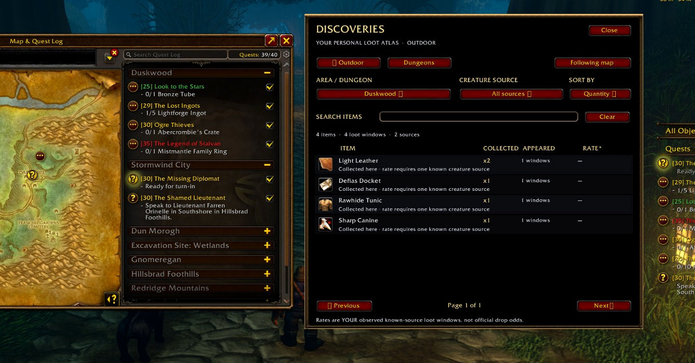
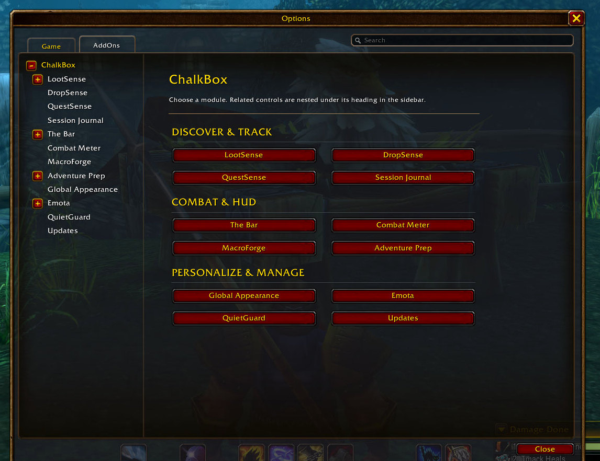
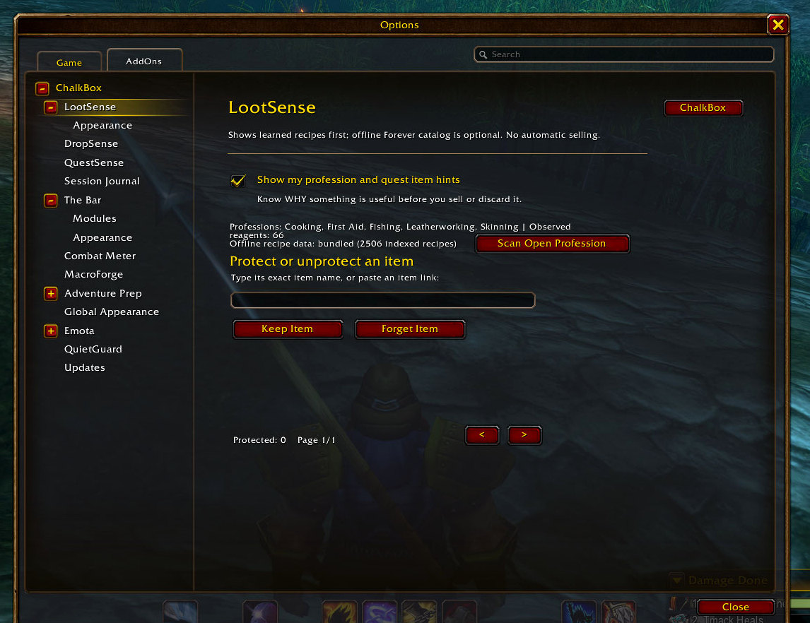
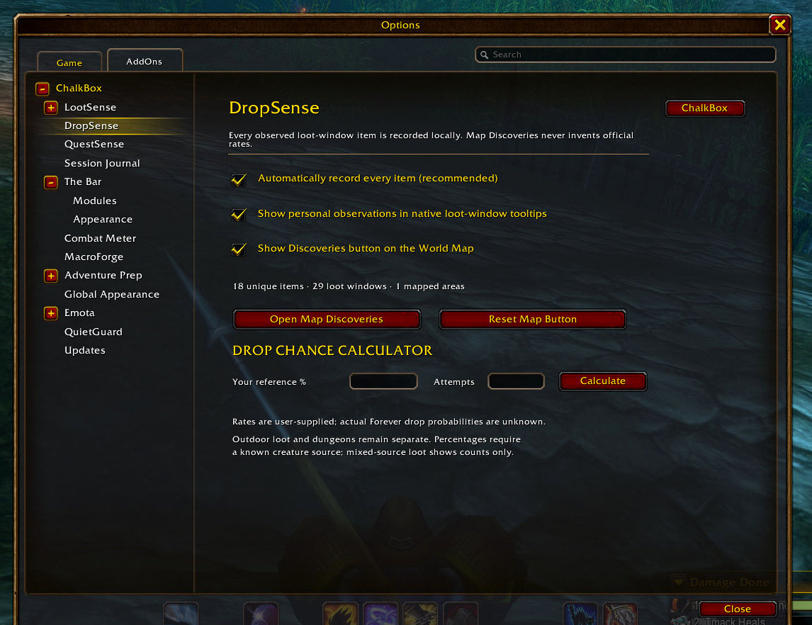
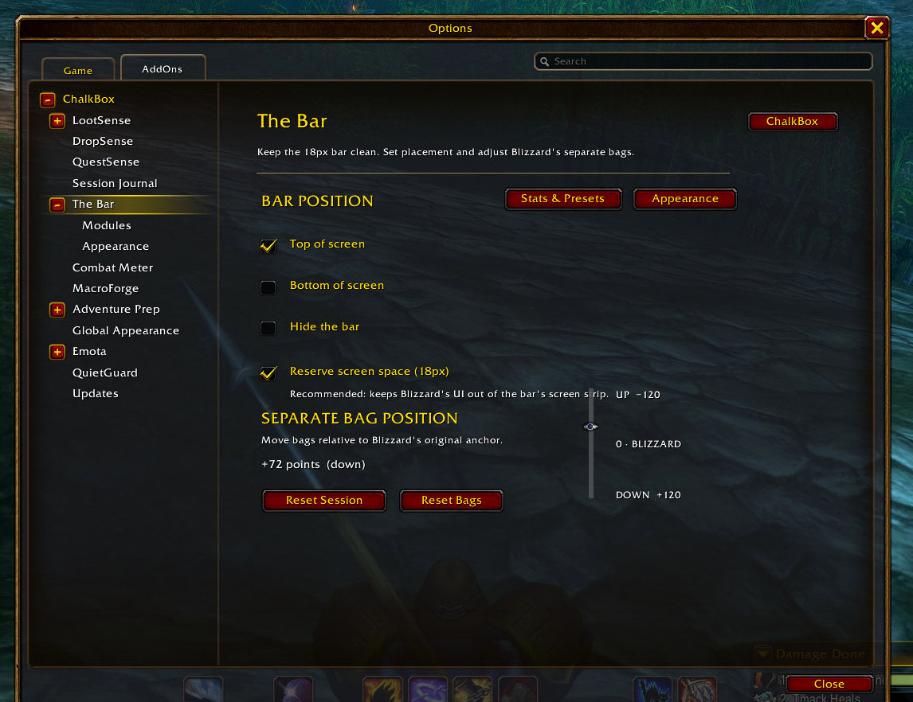
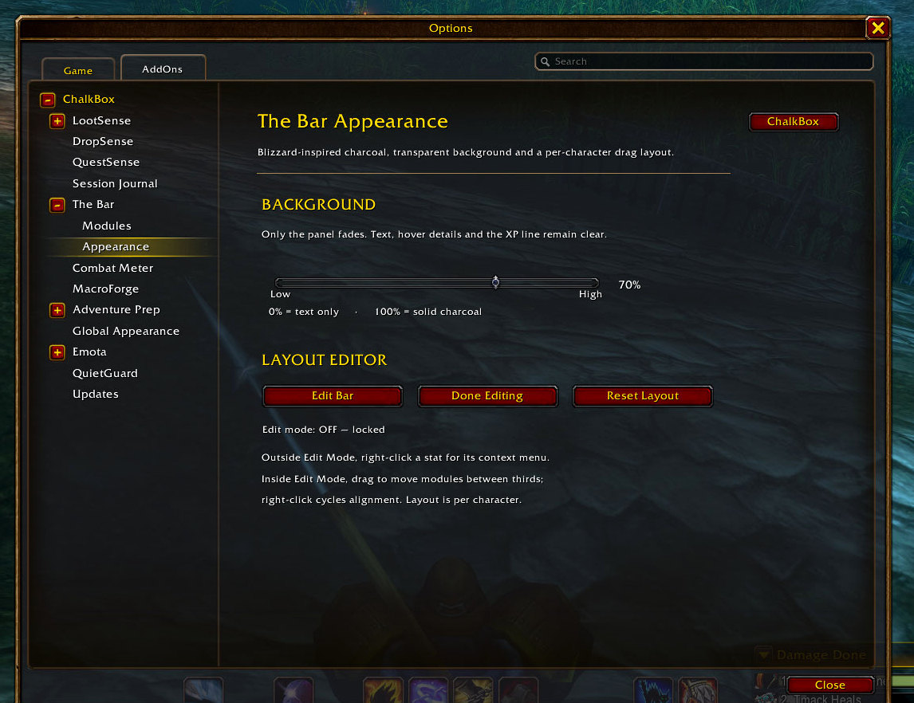
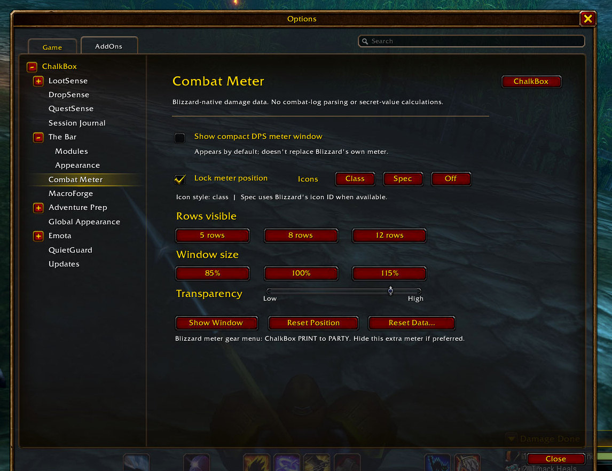
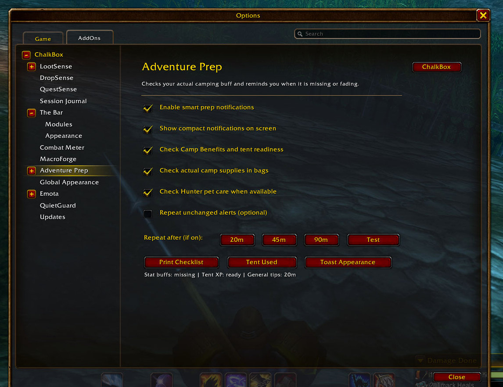
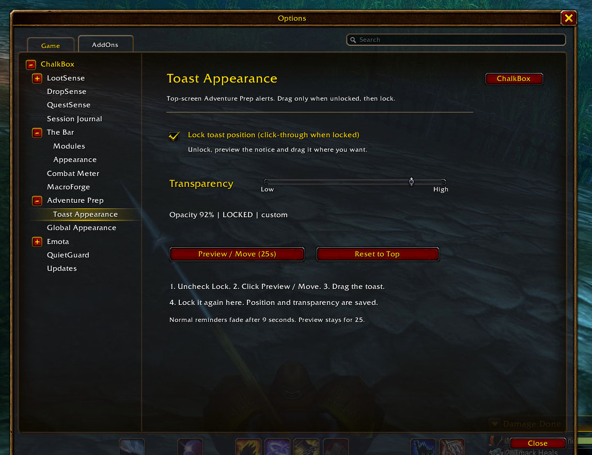
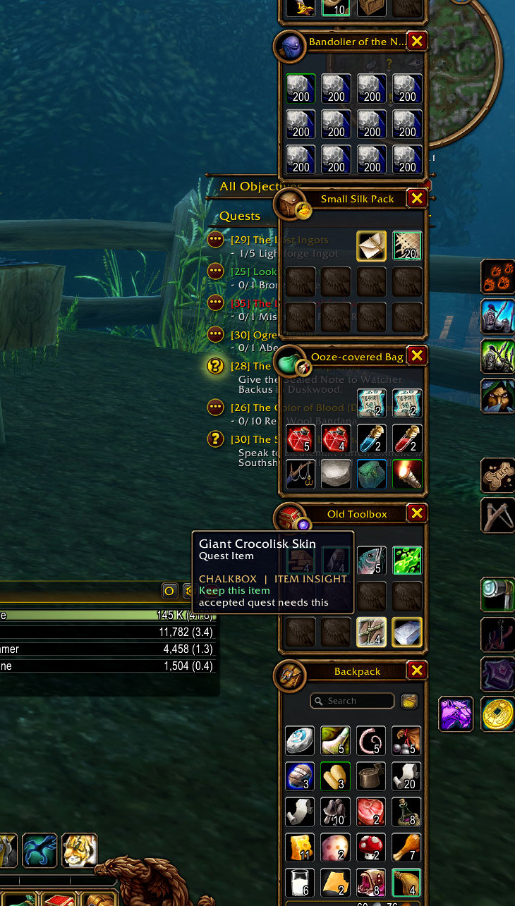

# ChalkBox screenshot gallery

Real **WoW Forever** gameplay captures, supplied by the addon author. These were cropped to keep the addon UI readable and leave out player nameplates and chat. No controls or values were invented or redrawn.

The shots show the 2.0.5 interface. The Discoveries image comes from the live-client capture after its journal rendering was repaired.

## Map Discoveries

Browse personally observed items by area and creature source directly from the world map.

## Main Settings

A single home for ChalkBox modules, grouped by purpose.

## LootSense

Profession hints and keep-item controls.

## DropSense

Configure personal loot observations.

## The Bar

Placement, HUD controls, and separate-bag positioning.

## Combat Meter

Configure the optional damage and healing window.

## MacroForge

Build macros from spells available to your character.

## Adventure Prep

Tent, supply, and pet-care reminders.

## Toast Appearance

Adjust the small notification display.

## Item Insight

An actual LootSense quest-item tooltip in the bag interface.

Screenshots are for the repository and CurseForge project gallery, **not** part of the playable addon ZIP. The separate CurseForge media ZIP includes all these images.
